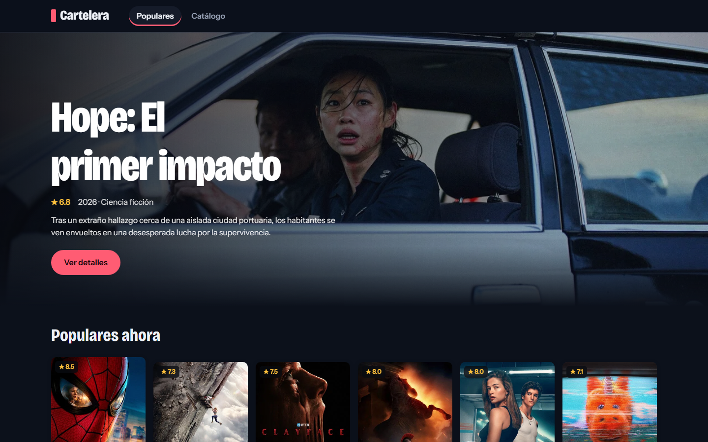
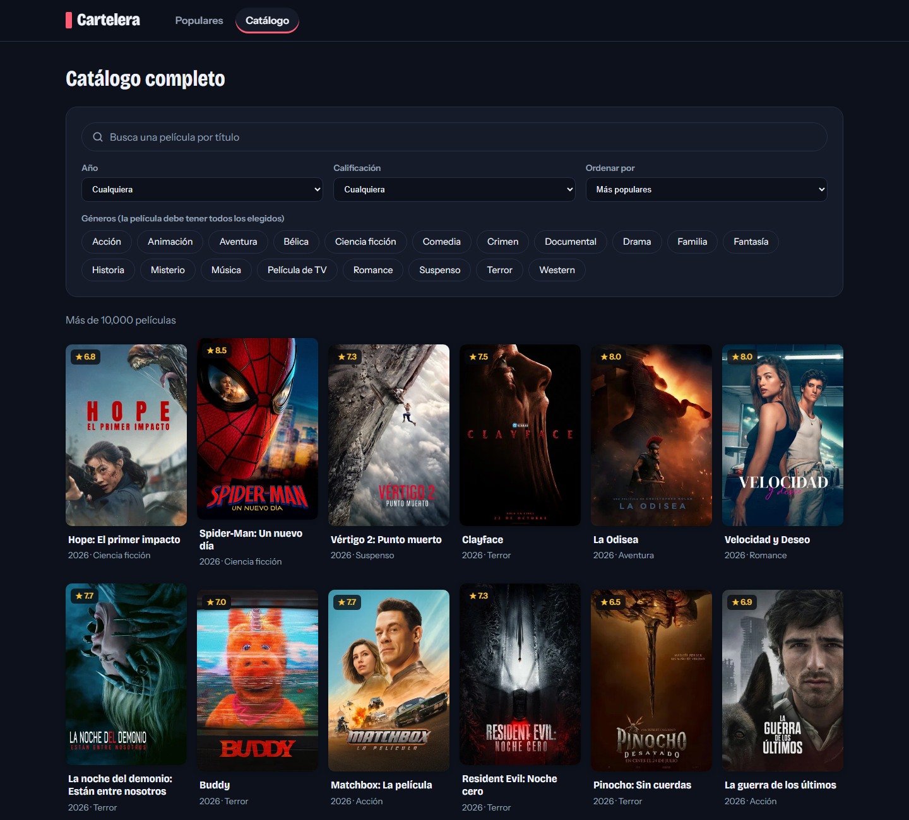

# Cartelera

Aplicación web para explorar películas con la API de [TMDB](https://www.themoviedb.org/), en español (`es-MX`). Tiene dos secciones:

- **Populares:** una selección corta (una portada destacada y 11 películas) para descubrir qué ver ahora.
- **Catálogo:** todas las películas, con un buscador avanzado: texto, géneros (varios a la vez), año, calificación mínima y orden (populares, mejor calificadas, más recientes o más antiguas). Paginado con «Cargar más».

Desde cualquier tarjeta se abre el detalle (póster, sinopsis, géneros, duración y calificación).

Proyecto de la **Tarea 2** (consumo de una API externa).

## Capturas





## Tecnologías

- **Frontend:** React 18 + Vite
- **Backend:** un proxy mínimo con Express (Node) que habla con TMDB
- **API externa:** TMDB v3

## Requisitos

- [Node.js](https://nodejs.org/) **22.9 o superior** (el servidor usa `--env-file-if-exists`)
- Una cuenta gratuita en TMDB y su API key

## Cómo ejecutarla

1. Clona el repositorio e instala las dependencias:

   ```bash
   git clone https://github.com/Juulren/cartelera-tmdb.git
   cd cartelera-tmdb
   npm install
   ```

2. Consigue tu clave en [themoviedb.org](https://www.themoviedb.org/settings/api) (*Settings → API*). Sirven la **API Key** (v3) o el **API Read Access Token** (v4, empieza con `eyJ`).

3. Crea tu archivo `.env` a partir de la plantilla y pega la clave:

   ```bash
   cp .env.example .env
   ```

   ```
   TMDB_API_KEY=tu_clave_aqui
   ```

4. Arranca todo con un solo comando:

   ```bash
   npm run dev
   ```

5. Abre <http://localhost:5173>.

Otros comandos: `npm run build` (compila el frontend a `dist/`), `npm run server` (solo el proxy).

## Cómo se protege la API key

La clave **nunca llega al navegador ni al repositorio**:

- Vive solo en `.env`, que está en `.gitignore`. En el repo solo hay `.env.example` con un valor falso.
- El navegador llama a `/api/...` (nuestro proxy en `server/index.js`) y es el servidor quien agrega la clave al hablar con TMDB.
- No se usa ninguna variable `VITE_*`, porque Vite las incrusta en el código que se descarga el navegador.

El proxy escucha en el puerto 3001 (`API_PORT` lo cambia) y Vite reenvía `/api` hacia él en desarrollo.

## Manejo de errores

| Situación | Qué ve el usuario |
|---|---|
| Sin conexión | Banner "Sin conexión" y reintento automático al volver la red |
| Respuesta vacía | "No se encontraron películas para «…»" |
| Límite de peticiones (429) | Mensaje con cuenta regresiva; Reintentar se activa al terminar |
| Key inválida o ausente | Mensaje que indica revisar el `.env` |
| Timeout (8 s) o servidor caído | "El servicio no está respondiendo" y botón Reintentar |

## Cómo funcionan los filtros

Sin texto, el catálogo usa `/discover/movie` de TMDB, que filtra y ordena en el servidor de TMDB (por eso funciona sobre todo el catálogo). La búsqueda por texto usa `/search/movie`, que solo acepta el año; con texto, el género, la calificación y el orden se aplican sobre los resultados ya cargados, y la app lo avisa en pantalla.

Si el usuario escribe rápido, las peticiones anteriores se cancelan para que no lleguen resultados viejos.

## Estructura

```
server/index.js          Proxy Express: /api/popular, /api/search, /api/discover, /api/movie/:id
src/api/movies.js        Cliente de la API, timeout y errores tipificados (ApiError)
src/hooks.js             useDebounce, useOnlineStatus, useCountdown
src/components/          FilterBar, SearchBar, Hero, MovieGrid, MovieCard, MovieDetail (modal), StatusMessage
src/App.jsx              Barra superior, pestañas (hash #populares / #catalogo) y modal
src/views/               PopularView (selección corta) y CatalogView (catálogo con filtros)
src/usePagedMovies.js    Hook compartido: paginación, cancelación, reintentos y errores
```

## Declaración de uso de IA

> Se permite y se espera el uso de IA, siempre que se declare.

### Herramientas y para qué las usé

| Herramienta | Para qué la usé |
|---|---|
| Claude Code (modelos Claude de Anthropic) | Planear la arquitectura; generar el código del proxy Express y de los componentes de React; depurar errores (conflicto con la variable PORT, procesos viejos en el puerto); probar la app en el navegador; rediseñar la interfaz; redactar el README, la bitácora y los mensajes de commit. |

### Qué hice yo sin ayuda de IA

- Crear mi cuenta de TMDB y obtener la API key, y guardarla en mi archivo .env (nunca se sube al repositorio).
- Crear el repositorio en GitHub.
- Decidir el tema y el alcance: una app de películas con TMDB, con una sección Populares corta y un Catálogo completo con buscador avanzado.
- Probar la app a mano, detectar los fallos ("Cargar más" y "No se pudo contactar al servidor") y reportarlos; reiniciar el servidor cuando hizo falta.
- Revisar el diseño y pedir los cambios (más vida visual; separar Populares del Catálogo).

Debo poder explicar cualquier línea del código; lo que no pueda explicar no cuenta como mío.

Los prompts, los errores de la IA y lo aprendido están en [`BITACORA.md`](BITACORA.md) y, en Word, en [`docs/Bitacora-IA-Cartelera.docx`](docs/Bitacora-IA-Cartelera.docx).

## Créditos

Este producto usa la API de TMDB pero no está respaldado ni certificado por TMDB. Los datos y las imágenes de películas pertenecen a [The Movie Database (TMDB)](https://www.themoviedb.org/).
